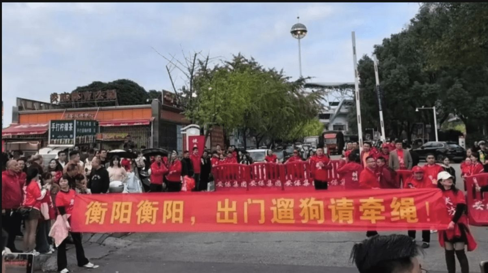

一句话先说结论：**这块横幅在西方也一样会被处理，但很少会先拘人。**

差别不在“管不管”，而在“怎么管”。

<!--more-->

*11月15日赛前，娄底球迷在场外拉起的横幅：“衡阳衡阳，出门遛狗请牵绳！”*

## 发生了什么

- 2026年11月15日，湘超四分之一决赛，娄底主场对阵衡阳。开赛前，个别人员在场外喊不文明口号、拉侮辱性横幅。
- 11月16日，娄底赛区组委会通报：刘某某、王某被行政拘留5日，其他人警告、罚款。依据是《治安管理处罚法》第28条。
- 先纠一个说法：**这不是法院判的，也不是刑事罪。** 是公安机关的行政拘留，不是《刑法》第293条寻衅滋事罪。通报引的也不是“寻衅滋事”，而是第28条“扰乱大型群众性活动秩序”，其中一款就是“展示侮辱性标语、条幅”。

第28条是2025年修订、2026年1月1日施行的新法。一般是警告或500元以下罚款，情节严重的，处5–10日拘留。这次的5日，是“情节严重”档的下限。

“出门遛狗请牵绳”本身不脏，但对着客场球迷喊，意思就是把对方比作狗。算不算侮辱，争议不大；争议在**够不够得上拘留那档**。通报没有公布拉横幅的人数、对方球迷是否在场、有没有劝阻后仍不停止，这些都没说。

## 西方会怎么处理

| 地方 | 同样横幅，通常怎么处理 |
|---|---|
| 中国（本案） | 2人行政拘留5日 |
| 英国 | 罚款约300–1000英镑，加3年足球禁令 |
| 美国 | 政府基本不管，俱乐部驱逐出场、禁入最长1年 |
| 德国 | 按收入算的罚金，加多年球场禁令 |
| 法国 | 罚俱乐部2000–20000欧元，加部分看台关闭 |
| FIFA/UEFA | 罚俱乐部约1万欧元，不拘个人 |

几点补充，读表的时候用得上：

- **英国：** 理论上可以按《公共秩序法》起诉，但第一次、非暴力、非种族歧视的侮辱，坐牢极不可能。真正重的是“三年不能看球”。2023年有球迷穿嘲讽希尔斯堡惨案的衬衫，被罚1000英镑加4年禁令。
- **美国：** 反差最大。第一修正案管的是政府，公共场所的泛泛侮辱受保护；私人球场可以按票务条款赶人、禁入，但抓的不是那句话。只有拒不离开、或被禁入后又回来，才可能因非法侵入被捕。
- **德国：** 《刑法》第185条公开侮辱最高可判2年，但要受害人投诉、还要找得到具体受害人，对“一整座城市的球迷”这种泛泛对象很难成立。实际就是罚金加禁令。多特蒙德球迷辱骂霍芬海姆老板霍普，足协罚了5万欧元，整个球迷群体被禁了两个赛季的客场。
- **法国：** 最接近的镜像案在2026年2月，巴黎球迷把马赛人比作老鼠，联赛罚俱乐部1万欧元，加两次部分看台关闭，没有个人被拘留。

## 到底严不严

**中国更严的地方：**

- 为一句非歧视性侮辱失去人身自由，而且是警察不经法院作出的。
- 不需要证明某个具体的人被骚扰、有人投诉，也不要求可能引发暴力，只问活动秩序是否被扰乱。
- 第二天就出结果，程序快，裁量也大。

**中国没那么严的地方：**

- 西方没一个地方把球场当言论自由的法外之地，拉这块横幅在伦敦、慕尼黑、巴黎一样会被赶出去、禁入、罚款。
- 禁入时间西方往往更长：英国3年，法国司法禁令最长5年。
- 罚俱乐部的钱西方重得多：欧足联1万欧元、法甲2万欧元、德国足协5万欧元，只是罚的是俱乐部，不是拉横幅的人。

**最关键的一条线，是“歧视”。**

在西方，同样一句话是低级别处理，*除非*加上种族、民族、宗教、性别、性取向这些要素。欧足联对非歧视横幅只罚款，对歧视横幅是罚款加关看台；法国的歧视性侮辱最高1年加4.5万欧元，非歧视的只有1.2万欧元罚款。把对手比作“狗”是因为他们支持衡阳，这在西方属于“对手侮辱”，不是歧视侮辱。

## 最后一句

理性评价不该只站队“该罚”还是“罚重了”，而该追问三件事：**公布完整事实，区分横幅和口号各自起了什么作用，并说明白为什么是拘留而不是警告或罚款。** 说理越透，处罚越站得住。

## 来源

- 《中华人民共和国治安管理处罚法》（2025年修订）第28条、第30条
- 英国《1986年公共秩序法》第5条、第4A条；足球禁令指南
- 美国 *Cohen v. California*（1971）、*Snyder v. Phelps*（2011）
- 德国《刑法》第185条；德国联邦宪法法院球场禁令裁定（2018）
- 法国 Service-public 球场禁令说明；欧足联纪律条例第14条、第16(2)(e)条
